# Zippzo Quick-Commerce Platform
## Complete System Design & Architecture

**Version:** v3.7 (final)
**Document type:** Master architecture reference
**Audience:** Engineers, architects, ops

---

# 1. Executive Summary

Zippzo is a **hybrid quick-commerce platform** delivering groceries and FMCG to customers within 10–40 minutes via a network of Mother Hubs (MH) and Dark Stores (DS), served by a fleet of gig riders.

**The system comprises:**

- **6 client applications** (customer, rider, staff, admin, support, partner portal)
- **1 modular-monolith backend** with 19 bounded contexts
- **1 event-driven integration layer** (outbox → Redis Streams → handlers)
- **1 real-time layer** (WebSocket + push)
- **1 data platform** (PostgreSQL + PostGIS, TimescaleDB, Redis, S3)
- **1 immutable stock ledger** with hash-chained auditability

**Core architectural principles:**

| Principle | Consequence |
|---|---|
| MH controls, DS fulfils, rider delivers | Clear separation of concerns across network |
| Every physical touch is a scan | Barcode master is a launch blocker |
| Stock is not sellable until putaway confirms | Receipt ≠ availability |
| Custody is always recorded; task actions are CAS-gated | Physical truth can't be lost |
| POD is evidence; state is server-authoritative | Fraud-resistant delivery |
| COD is an operating mode, not a payment method | Cash ledger is a first-class citizen |
| WS carries hints; REST carries truth | Offline resilience is inherent |

---

# 2. System Context (C4 Level 1)

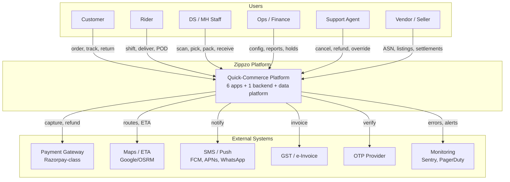

**What Zippzo is not:** not a marketplace-only, not a traditional e-comm, not a 3PL aggregator. It owns the fulfilment network end-to-end.

---

# 3. Container Architecture (C4 Level 2)

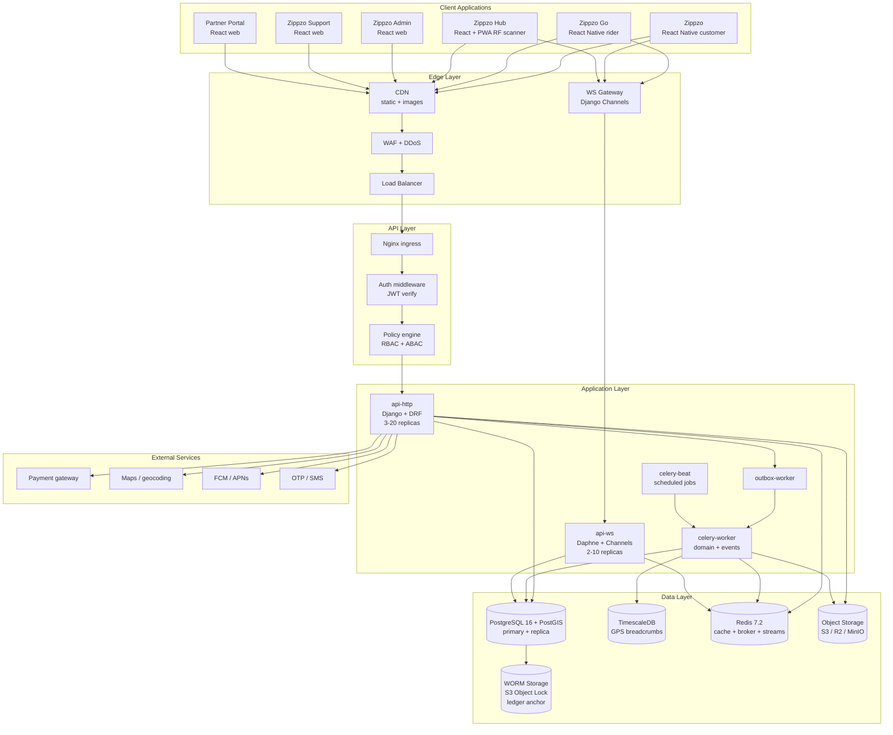

**Key architectural decisions:**

| Decision | Rationale |
|---|---|
| Modular monolith (not microservices) | Team size, transaction boundaries, single DB transaction for ledger writes |
| Separate `api-http` and `api-ws` | WS needs long-lived connections; HTTP needs fast scaling |
| Redis Streams for replay | Pub/sub loses events on reconnect; streams preserve cursor |
| Separate TimescaleDB instance | GPS write volume would pollute OLTP; invariant #26 |
| WORM anchor for hash chain | Tamper-evidence requires immutable external store |

---

# 4. Bounded Context Architecture (C4 Level 3)

The backend is organized into **19 bounded contexts**, each with clear ownership. No shared tables across contexts; cross-context communication is via events or explicit service calls.

## 4.1 Context Map

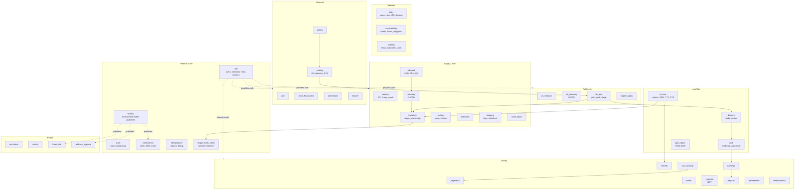

## 4.2 Context Ownership Table

| Context | Owns | Consumes |
|---|---|---|
| `iam` | Users, sessions, roles, devices, QR codes | — |
| `audit` | Immutable action log | Events from all contexts |
| `outbox` | Transactional event queue | Writes from all contexts |
| `inventory` | Stock ledger, movements, balances, LPNs, ownership, holds | Putaway, transfer, pick, sort, ship events |
| `inbound` | ASN, GRN, QC | Vendor data, barcode master |
| `putaway` | Putaway tasks (GATED) | Inbound, site config |
| `orders` | Customer orders, cart, lines | Catalog, routing, payments |
| `routing` | DS selection, ETA | Serviceability, inventory, GPS |
| `ds_ops` | Pick tasks, pack tasks, staging | Orders, inventory, rider bins |
| `delivery` | Delivery tasks, routes, rider shifts | Orders, DS ops, GPS |
| `pod` | POD evidence (never discarded) | Delivery, orders |
| `cod_custody` | Cash ledger, ceiling, remittance | Delivery, payments |
| `payments` | Payments, capture, gateway integration | Orders, COD |
| `refunds` | Refund state machine, cap enforcement | Payments, returns |
| `reverse` | Return orders, RTO, RTV, RTS, QC | Delivery, inventory |
| `sellers` | Seller lifecycle, listings, settlements | Catalog, money |
| `vendors` | Vendor master, PO, 3-way match | Inbound, money |
| `fraud_risk` | Trust scores, fraud signals | All order/payment events |
| `gps_ingest` | Real-time positions (Redis GEO) | Rider app stream |

**Rule:** one context = one owner. No context reads another context's tables directly. Cross-context reads go through service interfaces; writes go through events.

---

# 5. Data Architecture

## 5.1 Data Store Topology

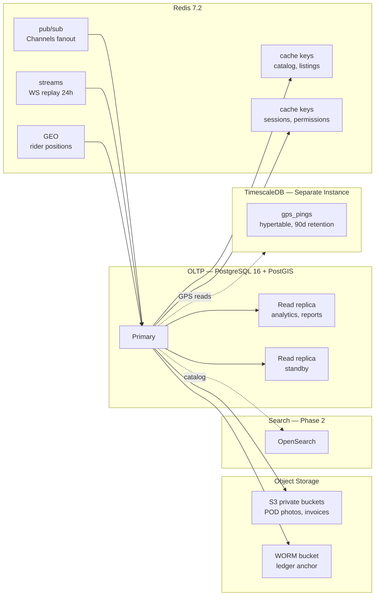

## 5.2 Core Data Model — Inventory Ledger

The **single source of truth** for all stock.

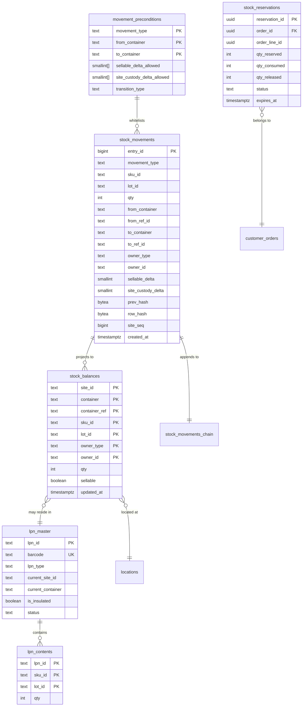

## 5.3 Data Flow: How Stock Updates

```mermaid
sequenceDiagram
    participant App as Any app
    participant API as API
    participant INV as Inventory service
    participant TRG as DB triggers
    participant BAL as stock_balances
    participant LED as stock_movements
    participant CH as hash chain
    participant OUT as outbox

    App->>API: scan event (e.g., putaway confirm)
    API->>INV: apply_movement(triple, qty, deltas)
    INV->>INV: validate against precondition whitelist
    INV->>LED: INSERT movement
    LED->>CH: compute row_hash from prev_hash
    CH->>CH: update chain head (transactional)
    LED->>TRG: AFTER INSERT trigger
    TRG->>BAL: apply delta (upsert)
    TRG->>BAL: CHECK qty >= 0
    INV->>OUT: INSERT outbox_event (same tx)
    INV->>INV: COMMIT
    Note over LED,BAL: Ledger is truth; balances are projection
```

**Rule:** no app writes `stock_balances` directly. Only the trigger does, on every `stock_movements` insert.

## 5.4 Data Classes & Retention

| Data class | Store | Retention | Driver |
|---|---|---|---|
| Stock movements | PostgreSQL (partitioned monthly) | 7 years | Financial compliance |
| Hash chain anchors | S3 WORM | 7 years | Audit tamper-evidence |
| GPS pings | TimescaleDB | 90 days | DPDP, ops |
| POD photos | S3 | 180 days | Dispute, chargeback |
| Invoices | S3 + PG | 8 years | GST statutory |
| Audit log | PostgreSQL (partitioned) | 7 years | Compliance |
| Notifications | PostgreSQL | 90 days | Ops |
| Support tickets | PostgreSQL | 3 years | Ops |
| Customer PII | PostgreSQL (encrypted) | Active + 3 years | DPDP |
| Sessions | Redis + PG | Active + 30 days | Security |

---

# 6. Integration Architecture

## 6.1 Event-Driven Backbone

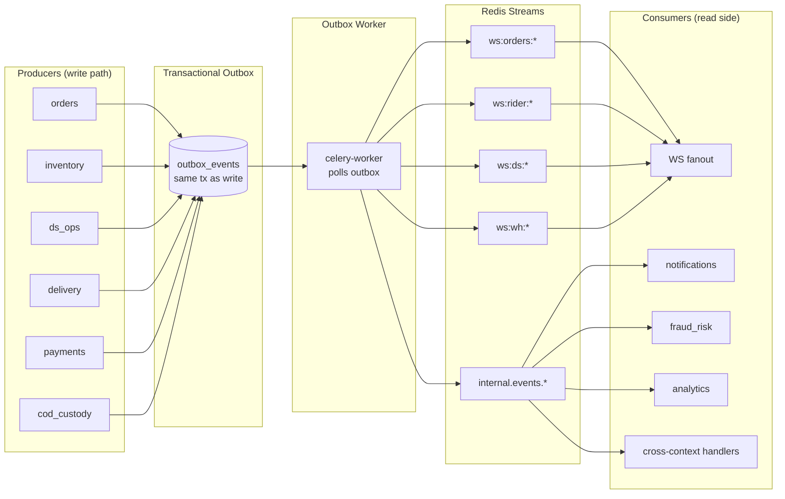

**Guarantees:**

| Property | Mechanism |
|---|---|
| At-least-once delivery | Streams retain until ack; worker retries |
| Ordering per aggregate | `(aggregate_id, sequence)` monotonic in stream |
| Idempotent handlers | Handler uses `client_event_id` / `outbox_id` for dedup |
| No events for uncommitted writes | Outbox insert in same DB transaction |
| Replay for reconnecting clients | Redis Streams with 24h cursor window |

## 6.2 Synchronous API Layer

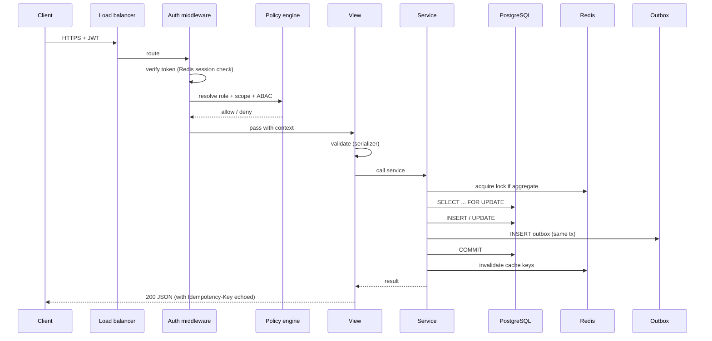

**Rules:**

- Every write includes an outbox row in the same transaction
- Every aggregate-invariant write takes an advisory lock before read
- Every cache key has a defined invalidation event

## 6.3 Real-Time Layer

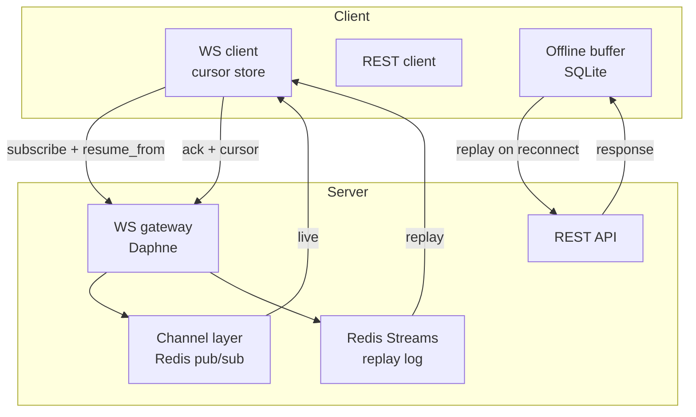

**Channel taxonomy:**

| Channel | Subscribers | Events |
|---|---|---|
| `ws/orders/{id}` | Customer (per active order) | Status, rider location, ETA, POD trigger |
| `ws/rider/{id}/tasks` | Rider | Offers, task updates, withdrawals |
| `ws/rider/{id}/custody` | Rider | Threshold alerts, remittance due |
| `ws/ds/{id}/pick-queue` | Pickers | New orders, priority changes |
| `ws/ds/{id}/arrivals` | DS staff | Rider approaching |
| `ws/ds/{id}/alerts` | DS staff | Low stock, holds, aging |
| `ws/wh/{id}/tasks` | WH staff | Inbound, putaway, outbound |
| `ws/admin/live-ops` | Admin | Snapshot + tail |
| `ws/admin/holds` | Admin | Holds aging |

## 6.4 External Integrations

| Integration | Direction | Protocol | Frequency |
|---|---|---|---|
| Payment gateway | Out (initiate), In (webhook) | REST + webhook | Per order |
| Maps / routing | Out | REST | Per route decision |
| Push (FCM/APNs) | Out | REST | Per notification |
| SMS / WhatsApp | Out | REST | Per OTP / alert |
| OTP provider | Out | REST | Per auth |
| GST / e-invoice | Out | REST | Per delivered order |
| Weather feed | In | REST | Every 15 min per DS |
| Weighbridge | In | Serial/TCP adapter → REST | Per vehicle |
| Label printer | Out | ZPL over network | Per label |
| RF scanner | In | Native app → REST | Continuous |

---

# 7. Deployment Architecture

## 7.1 Kubernetes Topology

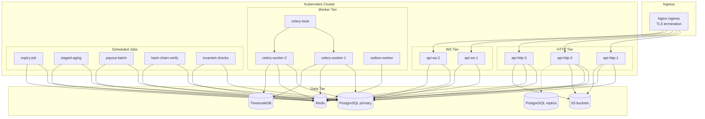

## 7.2 Environment Strategy

| Env | Purpose | Deploy trigger | Data |
|---|---|---|---|
| `local` | Dev machines | Manual | Seeded fixtures |
| `dev` | Integration | Every merge to `main` | Anonymized seed |
| `staging` | Pre-prod | Release tag | Weekly prod copy (anonymized) |
| `prod` | Live | Manual approval after staging | Real |

**Parity rule:** same Docker image across all environments; only config differs.

## 7.3 Deployment Flow

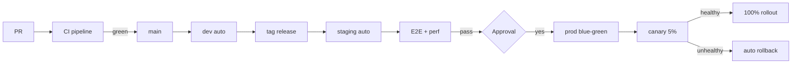

## 7.4 Autoscaling

| Service | Metric | Min | Max |
|---|---|---|---|
| api-http | CPU 70% OR RPS | 3 | 20 |
| api-ws | active connections | 2 | 10 |
| celery-worker | queue depth | 2 | 15 |
| outbox-worker | outbox lag | 1 | 5 |

---

# 8. Security Architecture

## 8.1 Defense in Depth

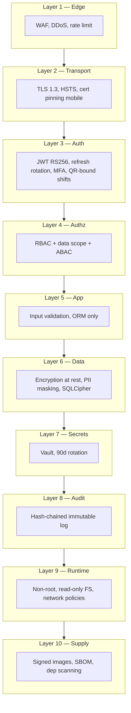

## 8.2 Authentication by Client

| Client | Method | Access TTL | Refresh | Device bind |
|---|---|---|---|---|
| Customer | Phone + OTP | 15 min | 30 days | No (OTP is factor) |
| Rider | Phone OTP + device bind + QR shift | 15 min | 30 days | Yes |
| Staff | Badge + PIN | **30 min shift-bound** | **None** | Yes (scanner) |
| Admin | Email + MFA | 15 min | 8h | Yes |
| Service | mTLS + API key | — | Rotated 90d | Yes |

## 8.3 Authorization Model

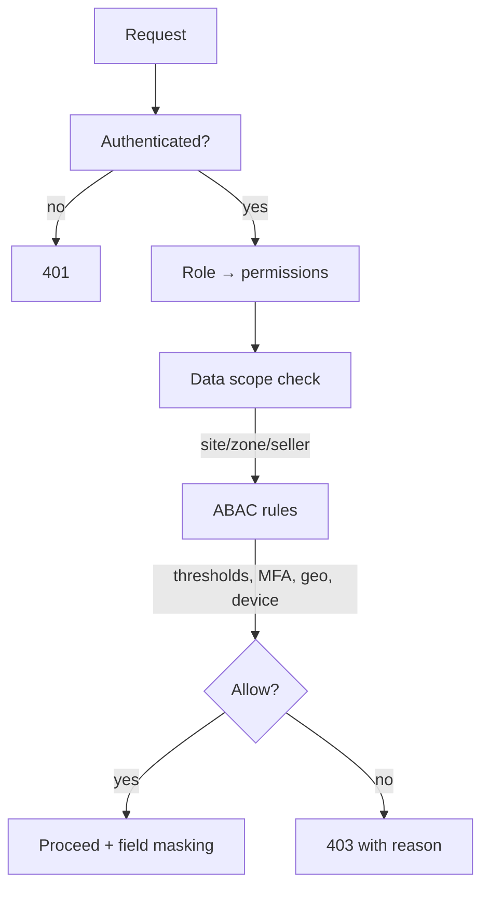

**Three layers enforced server-side, always.** UI hides; API enforces.

## 8.4 PII Handling

- Phone, email, address, bank → encrypted at column level (KMS)
- Logs redact PII via middleware
- Analytics uses hashed user IDs
- Right to erasure: soft-delete + anonymize after retention window
- PII access itself is logged in the audit trail

---

# 9. Observability Architecture

## 9.1 Three Pillars + Tracing

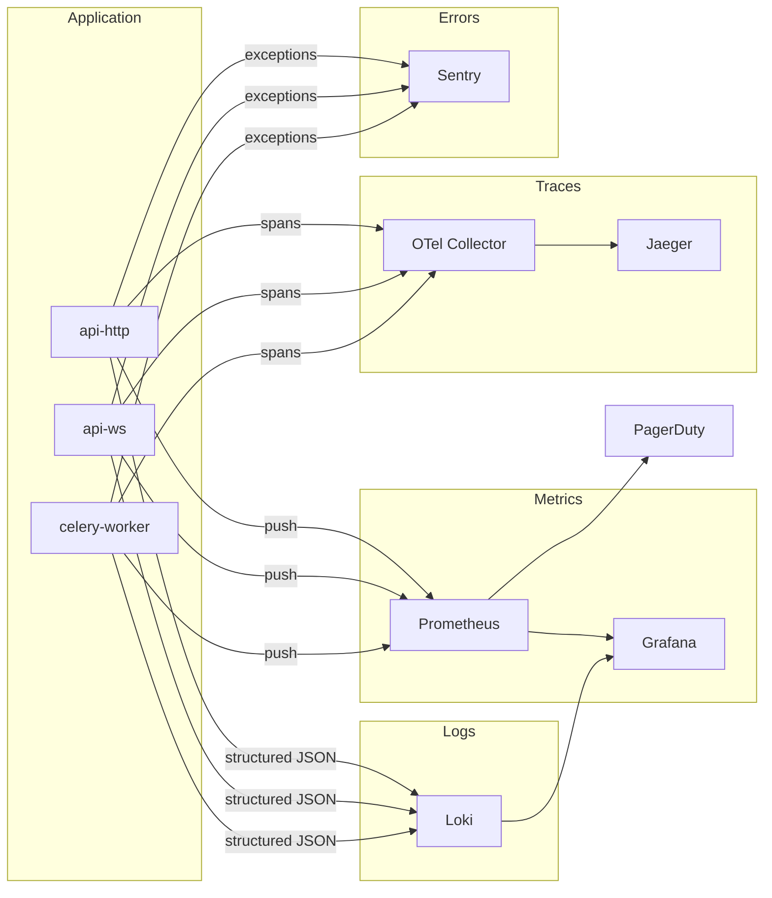

## 9.2 Golden Signals (per context)

| Context | Primary metric | Alert threshold |
|---|---|---|
| routing | p99 route decision | > 500 ms |
| ds_ops | pick queue depth | > 20 for 5 min |
| delivery | active riders / demand | < 1.2 |
| payments | capture success rate | < 95% over 5 min |
| cod_custody | rider cash / ceiling | > 90% |
| refunds | open refunds > T+2 | any |
| inventory | ledger mismatch | any (P1) |
| outbox | pending events | > 1000 |
| ws | drop rate | > 20% |
| gps_ingest | ingest lag | > 10 s |
| holds | unescalated > 72h | any |

## 9.3 Business KPIs (live dashboards)

- Orders/min (vs 1h avg)
- Fill rate (lines shipped complete)
- On-time dispatch %
- Dock-to-stock time
- Pick accuracy %
- Delivery SLA compliance %
- COD collection rate
- Rider utilization

---

# 10. Operational Workflows (End-to-End)

## 10.1 Vendor → MH → Shelf

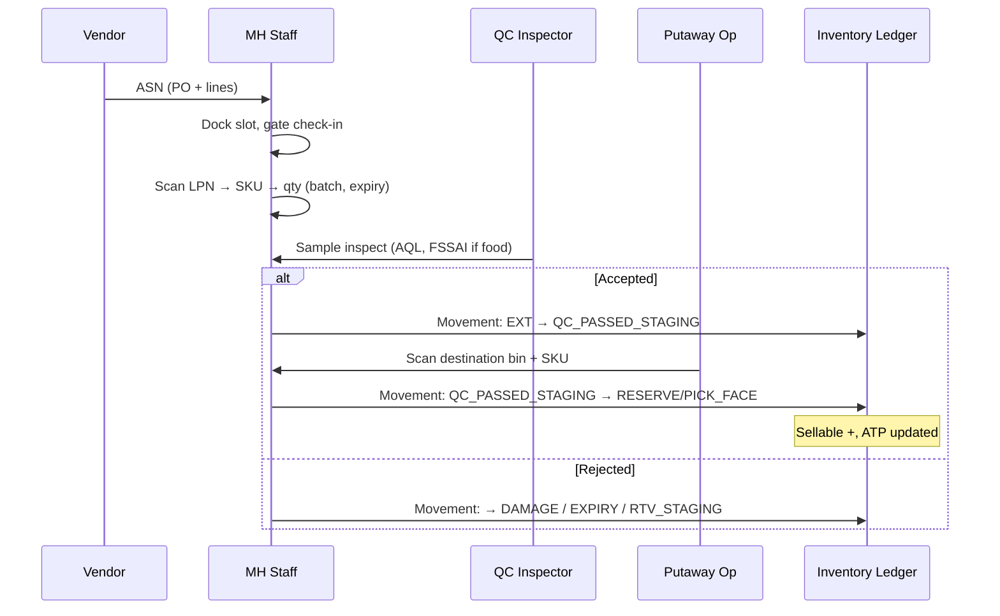

## 10.2 MH → DS Replenishment

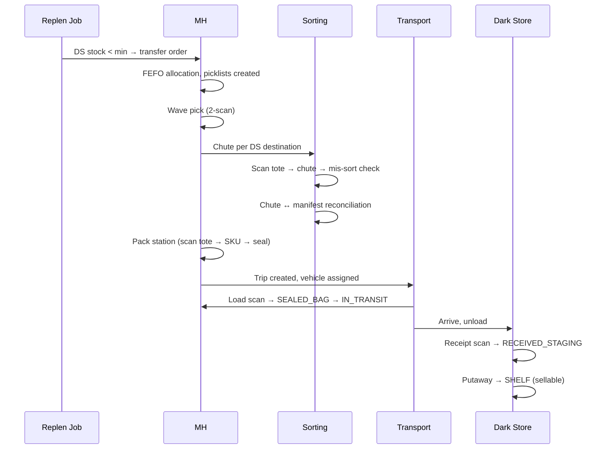

## 10.3 Customer Order (Core Revenue Flow)

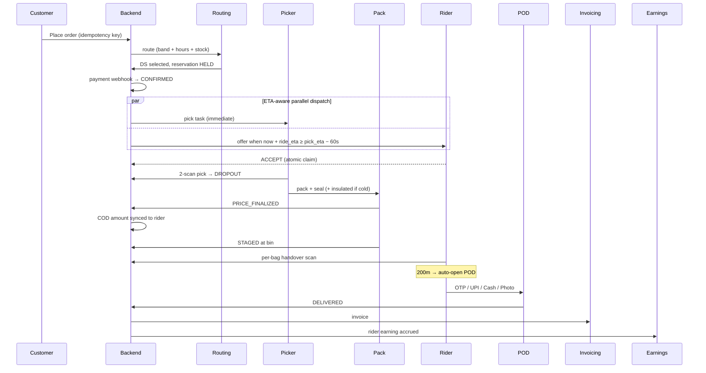

## 10.4 Return / RTO / RTV

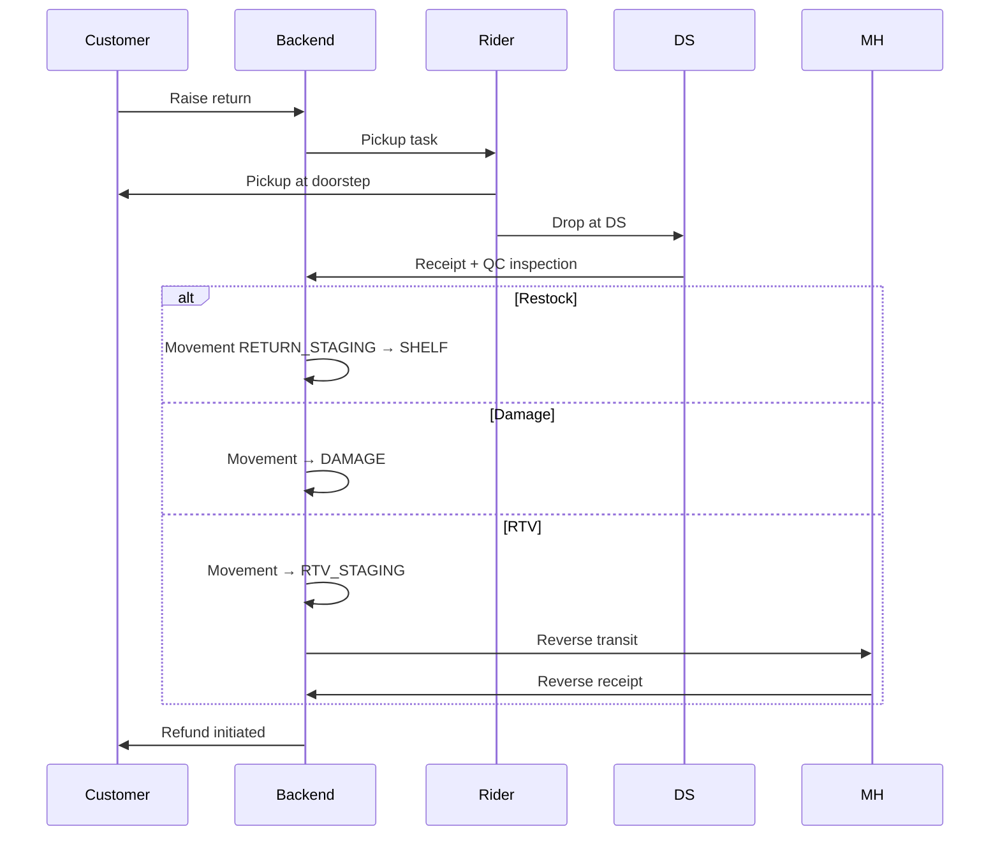

## 10.5 Cancel Arbiter

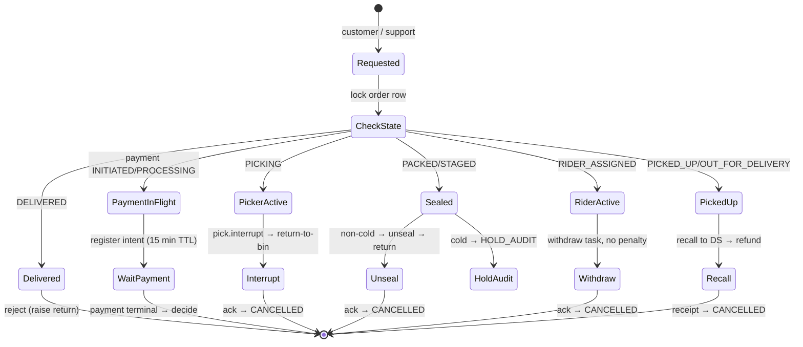

---

# 11. Non-Functional Requirements

| Category | Metric | Target |
|---|---|---|
| **Performance** | Order API p99 | < 300 ms |
| | Routing decision p99 | < 500 ms |
| | WS message latency | < 500 ms |
| | GPS ingest lag | < 5 s |
| **Scale** | Order throughput | 10k/hour/cluster |
| | Concurrent riders | 500/city |
| | Concurrent pickers | 200/DS |
| | WS connections | 50k/cluster |
| **Reliability** | Availability | 99.9% monthly |
| | RPO (PostgreSQL) | 5 min |
| | RTO (PostgreSQL) | 1 hour |
| | Outbox lag | < 5 min |
| **Security** | Auth TTL | 15 min access |
| | Audit retention | 7 years |
| | PII encryption | At rest + transit |
| **Compliance** | GST invoicing | Per delivered order |
| | DPDP retention | Enforced per data class |
| | FSSAI | Hard block on food |

---

# 12. Build & Delivery

## 12.1 Roadmap (49 weeks, 8–12 engineers)

| Phase | Weeks | Delivers |
|---|---|---|
| 0 | 2 | Foundation: IAM, outbox, idempotency, audit, hash-chained ledger, ownership columns |
| 1 | 2 | Multi-site, serviceability (bands + hours), barcode master, scanner registration |
| 2 | 3 | Vendor PO/ASN/GRN + gated putaway (MH) + license registry + bin/zone QR |
| 3 | 3 | DS inbound + gated putaway + go-live checklist |
| 4 | 4 | Hub: pick, pack, price finalization, bin transfer, staff shifts |
| 5 | 3 | Sorting + MH pack + TO lifecycle |
| 6 | 4 | Customer app + routing + COD flow + substitution prefs |
| 7 | 4 | Go app: QR shift, per-bag handover, POD, custody, earnings screen |
| 8 | 3 | Arbiter + ETA dispatch + batching + staged-aging |
| 9 | 3 | Wallet + refunds + clawback |
| 10 | 3 | GST invoicing + reconciliation |
| 11 | 3 | Reverse: returns/RTO/RTV/RTS |
| 12 | 2 | Holds + audit + DPDP + expiry sweep + cycle count |
| 13 | 2 | Support console + fraud + address hygiene |
| 14 | 4 | Single-DS pilot |
| 15 | 4 | Hardening + load + security + DR drill |

## 12.2 Launch Blockers

**Must ship:** gated putaway (MH + DS) · barcode master + scan resolution · bin/scanner/LPN masters · price finalization at pack · COD custody ledger + ceiling + exact-amount sync · cancel arbiter (lock ordering + advisory locks + mirror CAS) · return entity + RTV/RTS · GPS ingest (not outbox) · invoicing at DELIVERED · per-bag handover scan · penny-drop COD refunds · staged-aging engine · ledger ownership columns · movement preconditions + PENDING_CUSTODY · POD-evidence table · DB enum as single source + registry↔DB CI · minimal support console · earnings screen in rider app.

**Never defer:** ownership columns, barcode master, per-bag handover, arbiter, COD ledger, gated putaway, earnings screen.

## 12.3 Verification Mechanism

- **Matrix-as-data:** `matrix.yaml` → `matrix_expected` table; CI asserts seed ≡ matrix
- **Registry-as-law:** event schemas as JSON Schema; CI asserts producers/consumers exist
- **Scripted self-checks:** no prose assertions; all counts and checks are executed and pasted
- **Test suite:** 10 new cases + standing suite; PR-fast / nightly-slow / pre-release-chaos

---

# 13. Summary

**Zippzo is a fully specified quick-commerce platform with:**

| Element | Count |
|---|---|
| Client applications | 6 |
| Bounded contexts | 19 |
| Container types | 21 (14 physical, 3 virtual, 2 money, 2 terminal) |
| Movement matrix | 33 logical movements → 46 seed rows |
| Invariants | 33 |
| Pipelines | 26 |
| Event types | 48 |
| Companion specs | 16 |
| Build phases | 16 |
| Roadmap | 49 weeks |

**Architecture principles in one line each:**

1. **MH controls, DS fulfils, rider delivers** — clear separation
2. **Stock is not sellable until putaway confirms** — receipt ≠ availability
3. **Every physical touch is a scan** — barcode master is law
4. **Ledger is truth; balances are projection** — append-only, hash-chained
5. **Custody records are always accepted; task actions are CAS-gated** — physical reality can't be lost
6. **POD is evidence; state is server-authoritative** — fraud-resistant
7. **WS carries hints; REST carries truth** — offline resilience by design
8. **COD is an operating mode, not a payment method** — cash ledger is first-class
9. **Events written in the DB transaction that made the change** — no lost events
10. **Every aggregate invariant takes a lock before read** — no concurrent violations

**The design is complete. The next step is `make migrate` against real Postgres 16.**

---